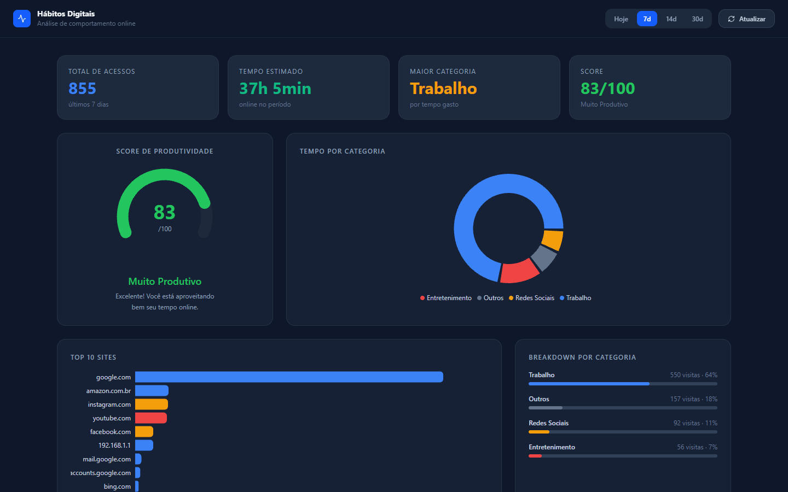

# Analisador de Hábitos Digitais

Você sabe quanto tempo passa no Instagram quando acha que está "só dando uma olhada"? Esse projeto responde isso.



Lê o histórico real do seu navegador, classifica cada site visitado por categoria e calcula um score de produtividade do seu dia — tudo exposto via API REST e visualizado num dashboard.

---

## O que ele faz

- Lê o histórico do Chrome, Edge ou Brave direto do disco
- Classifica cada site automaticamente: trabalho, estudo, redes sociais, entretenimento
- Calcula quanto tempo você estimou em cada categoria
- Gera um score de produtividade de 0 a 100
- Expõe tudo via API — filtrável por domínio, categoria e período
- Dashboard em React com gráficos, top 10 sites e histórico recente

Se não conseguir acessar o navegador (browser aberto, permissão negada), gera dados mock realistas pra API não quebrar.

---

## Stack

**Backend** — Python, FastAPI, SQLAlchemy, SQLite  
**Frontend** — React, Vite, Tailwind, Recharts, React Query

---

## Rodando o projeto

### Backend

```powershell
cd backend

uv venv .venv
uv pip install -r requirements.txt

.venv\Scripts\uvicorn.exe app.main:app --port 8000
```

> Não tem `uv`? `pip install -r requirements.txt` também funciona.

### Frontend

```powershell
cd frontend

npm install
npm run dev
```

| | URL |
|---|---|
| Dashboard | http://localhost:5173 |
| API | http://localhost:8000 |
| Swagger | http://localhost:8000/docs |

---

## API

| Endpoint | Descrição |
|---|---|
| `GET /logs` | Histórico armazenado, filtrável por domínio/categoria/período |
| `POST /logs/collect` | Dispara coleta manual do navegador |
| `GET /stats` | Total de acessos, top 10 sites, tempo por categoria |
| `GET /productivity` | Score 0–100 com breakdown por categoria |
| `GET /categories` | Lista categorias e keywords de classificação |
| `PATCH /categories/{id}` | Edita peso de produtividade ou cor |
| `POST /categories/{id}/keywords` | Adiciona keyword pra uma categoria |

### Como o score funciona

Cada visita vale `peso da categoria × tempo estimado na página`. O resultado é normalizado pra escala 0–100, com 50 sendo um dia neutro.

| Categoria | Peso |
|---|---|
| Trabalho | +2.0 |
| Estudo | +1.5 |
| Notícias / Outros | 0 |
| Entretenimento | -0.5 |
| Redes Sociais | -1.5 |

---

## Testes

```powershell
cd backend
uv pip install pytest httpx
.venv\Scripts\pytest.exe tests/ -v
```

---

## Estrutura

```
├── backend/
│   ├── app/
│   │   ├── database/     # engine, session, init_db
│   │   ├── models/       # BrowsingLog, Category, CategoryKeyword
│   │   ├── routes/       # logs, stats, productivity, categories
│   │   └── services/     # coleta, classificação, analytics, mock
│   ├── scheduler.py      # coleta automática em loop
│   ├── run.py            # sobe API + scheduler junto
│   └── tests/
└── frontend/
    └── src/
        ├── components/   # ScoreGauge, CategoryPieChart, TopSitesChart...
        ├── api.ts
        └── App.tsx
```
